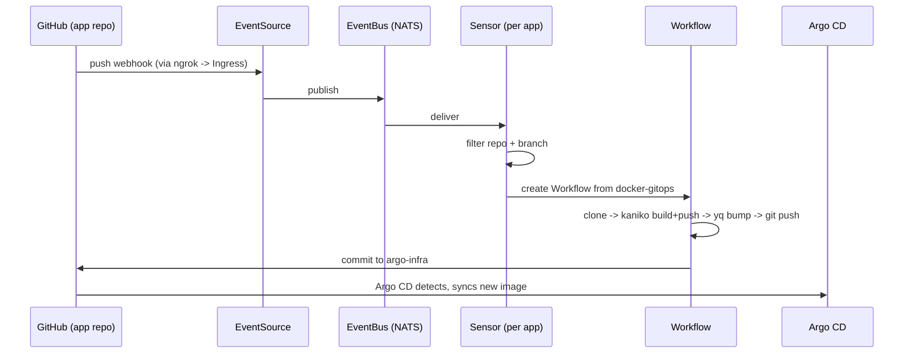

# argo-infra

GitOps control plane for a local Kubernetes cluster. Argo CD owns everything in
the cluster; Argo Workflows + Argo Events build and promote application images.

Everything is driven from this repository. Nothing is configured by hand except
secret material, which by design never enters git.

---

## 1. Bootstrap chain

```
kubectl apply -f root/root-app.yaml
        │
        ▼
root-app  (Argo CD Application, syncs root/applicationsets/)
        │
        ▼
5 ApplicationSets  (platform, applications, datastores, ci-cd, observability)
        │  each uses a git file generator globbing <category>/*/app.yaml
        ▼
N Argo CD Applications
```

One command bootstraps the cluster. Everything after that is `git push`.

### Discovery

Each ApplicationSet globs `<category>/*/app.yaml`. Dropping a new directory
with an `app.yaml` creates an Application; deleting it prunes one.

Apps are filtered by a selector, not by templating:

```yaml
selector:
  matchExpressions:
    - key: enabled
      operator: NotIn
      values: ["false"]
```

`enabled: false` removes the Application entirely (and prunes its resources).
It is not a "scale to zero" — it is a delete.

> **Gotcha:** the git generator caches. A brand-new `app.yaml` will not appear
> just because you refreshed `root-app`. Force the ApplicationSet itself:
>
> ```bash
> kubectl -n argocd annotate appset <category> \
>   argocd.argoproj.io/application-set-refresh=true --overwrite
> ```

---

## 2. `app.yaml` contract

Every app declares the same four keys, plus a source-specific block.

| Key | Meaning |
|---|---|
| `enabled` | `false` deletes the Application |
| `name` | Argo CD Application name |
| `namespace` | Destination namespace (auto-created) |
| `sourceType` | `git` or `external-helm` |

**`sourceType: git`** — a local chart at `<dir>/chart`:

```yaml
enabled: true
name: jarvis
namespace: apps
sourceType: git
```

**`sourceType: external-helm`** — an upstream chart with local values:

```yaml
enabled: true
name: redis
namespace: datastores
sourceType: external-helm

chart:
  repoURL: https://charts.bitnami.com/bitnami
  name: redis
  version: "19.6.4"
```

**`extraManifests: true`** — upstream chart *plus* a local chart applied
alongside it. Only `platform/external-secrets` uses this today: the upstream
chart installs the operator, the local chart adds the `ClusterSecretStore`.

The `templatePatch` block in each ApplicationSet turns these into either a
single `source` or a multi-`source` Application. **Path is derived from the
`app.yaml` location** — there is no `path:` key to set.

---

## 3. Layout

```text
root/
  root-app.yaml                 # bootstrap; apply once by hand
  applicationsets/              # one per category

platform/                       # operators and cluster services
  argocd/  argo-workflows/  argo-events/  argo-rollouts/
  external-secrets/  vault/  ingress-nginx/  keda/  reloader/

applications/                   # workloads (local Helm charts)
  jarvis/    app.yaml + chart/  # chart also owns its CI Sensor
  chat-app/  app.yaml + chart/

ci-cd/
  pipelines/                    # ACTIVE - Argo Workflows CI
    chart/templates/
      eventbus.yaml             # NATS JetStream broker
      eventsource.yaml          # GitHub webhook receiver
      workflowtemplate.yaml     # the build pipeline
      sensor-rbac.yaml          # sensor identity only
      external-secrets.yaml     # dockerhub + github creds
      webhook-ingress.yaml
  jenkins/                      # DISABLED - superseded, kept for reference

datastores/       redis (on), postgres (off)
observability/    prometheus (off)
```

---

## 4. CI/CD pipeline

Argo Events triggers Argo Workflows, which builds with Kaniko and writes the
new tag back to this repo. Argo CD then deploys it. Jenkins was the original
implementation and has been replaced — see §8.



### Ownership split — the central design decision

| Object | Lives in | Why |
|---|---|---|
| `EventBus`, `EventSource`, `Ingress` | `ci-cd/pipelines` | Shared infrastructure, app-agnostic |
| `WorkflowTemplate` | `ci-cd/pipelines` | One template for every app |
| `ExternalSecret`s, sensor RBAC | `ci-cd/pipelines` | Shared credentials |
| **`Sensor`** | **the app's own chart** | Carries app-specific build config |

There is **no central registry of applications**. An earlier design kept an
`apps:` list in the pipelines chart; it was removed because disabling an app
left an orphaned Sensor that still triggered builds and bumped tags for a
workload that no longer existed. Sensors now live and die with their app.

The only central list left is the webhook registration surface:

```yaml
webhook:
  repositories:
    - owner: ashish-splite
      names: [ai-agent-ts]
```

A single `EventSource` object can only be declared once, so this cannot be
distributed. It is inert — a stale entry means an event arrives, matches no
Sensor, and is dropped.

> **Constraint that forces this shape:** `EventBus`, `EventSource` and `Sensor`
> are all **namespaced**, and a Sensor can only reach an EventBus in its own
> namespace. So a Sensor declared in the jarvis chart must set
> `namespace: ci-cd` explicitly. The jarvis Application therefore manages a
> resource outside its own destination namespace. This is intentional.

### Adding an app to CI

1. Add the repo to `webhook.repositories` in `ci-cd/pipelines/chart/values.yaml`
2. Add a `ci:` block to the app's `values.yaml`
3. Copy `applications/jarvis/chart/templates/sensor.yaml`

The `ci:` block:

```yaml
ci:
  enabled: true
  namespace: ci-cd
  serviceAccount: argo-ci-sensor
  workflowTemplate: docker-gitops
  repository: ashish-splite/ai-agent-ts
  branch: main
  gitopsRepo: https://github.com/ashish-splite/argo-infra.git
  gitopsBranch: main
  valuesFile: applications/jarvis/chart/values.yaml
```

The Sensor reads the image from the chart's existing
`.Values.image.repository` rather than duplicating it.

### Workflow internals

`docker-gitops` is a 5-node DAG. **Each node is a separate pod**, which is why
the shared `/work` directory must be a PVC (`volumeClaimTemplates`).

```
clone -> build -> gitops-clone -> gitops-edit -> gitops-push
```

Currently fully serial. Tasks sharing a dependency would run in parallel.

Details worth knowing:

- **Kaniko, not Docker** — no daemon, no privileged container. Registry auth is
  a `dockerconfigjson` Secret mounted at `/kaniko/.docker`, so there is no
  `docker login` step and the credential never passes through a shell.
- **Result passing** — `clone` writes `/tmp/sha` and declares it an output
  parameter; downstream nodes reference
  `{{tasks.clone.outputs.parameters.sha}}`.
- **Tags are the short git SHA** of the *application* commit, never `latest`.
- **Token hygiene** — a `GIT_ASKPASS` helper keeps the PAT out of `.git/config`,
  out of `argv`, and out of the logs.
- **yq uses `strenv()`** to avoid shell/YAML quoting bugs.
- **`gitops-push` is idempotent** — no diff means no commit, so re-running a
  build produces no empty commits.
- **Push retries with rebase** up to 3 times; concurrent app builds all target
  the same branch.
- **`updateGitops: "false"`** builds and pushes an image without touching the
  GitOps repo — use for feature branches.

### Retention

```yaml
ttlStrategy:
  secondsAfterSuccess: 86400     # 1 day
  secondsAfterFailure: 259200    # 3 days
```

Failures are kept longer because **pod logs die with the Workflow**.

`podGC` is deliberately **not** set. No artifact repository is configured, so
pod logs are the only record of a build. Adding `podGC` would delete them.
Configure log archiving first, then enable it.

> etcd does not evict objects. Without `ttlStrategy`, Workflows accumulate
> until etcd hits its backend quota and the cluster goes **read-only**. That is
> an outage, not a self-correcting condition.

---

## 5. Secrets

```
Vault  -->  External Secrets Operator  -->  Kubernetes Secret  -->  workload
```

Apps consume plain Secrets by name via `envFrom.secretRef` and are unaware of
Vault. `ClusterSecretStore/vault-backend` authenticates with a static token
held in the `vault-token` Secret.

Required paths (KV v2 under `secret/`):

| Path | Keys | Consumer |
|---|---|---|
| `ci-cd/dockerhub` | `username`, `password` | Kaniko push |
| `ci-cd/github` | `username`, `token` | clone + GitOps push |
| `jarvis/app` | app env (`OPENAI_API_KEY`, …) | jarvis |

> **Vault runs in dev mode — storage is in-memory.** Every pod restart wipes
> all secrets and every `ExternalSecret` breaks until re-seeded. This is a
> known, accepted trade-off for a learning cluster.
>
> Persistence requires leaving dev mode, which additionally requires handling
> unseal on every restart *and* replacing the static root token (a real Vault
> generates a random one that must not be committed). The clean fix is
> Kubernetes auth for ESO. Deferred deliberately.

The GitHub PAT needs **repo** scope plus **webhook read/write**
(`admin:repo_hook`) — Argo Events registers the webhooks itself via the API.

---

## 6. Platform components

| Component | Namespace | Role |
|---|---|---|
| argocd | `argocd` | Reconciles everything |
| argo-workflows | `argo-workflows` | Runs CI DAGs in `ci-cd` |
| argo-events | `argo-events` | EventSource/Sensor controllers |
| external-secrets | `external-secrets` | Vault → Secret sync |
| vault | `vault` | Secret store (dev mode) |
| ingress-nginx | `ingress-nginx` | Ingress, reached via `minikube tunnel` |
| reloader | — | Restarts pods when their Secret changes |
| argo-rollouts, keda | — | Installed, not yet used |

`argo-workflows` sets `controller.workflowNamespaces: [ci-cd]` with
`workflow.rbac.create: true`, so **the chart creates the `argo-ci-workflow`
ServiceAccount and its RBAC in `ci-cd`**. Do not hand-write those — an earlier
version did and duplicated what the chart already provides. Only the *sensor*
identity is hand-written, because no chart supplies it.

---

## 7. Things that will bite you

1. **ApplicationSet git generator caches.** New `app.yaml` files need an
   explicit appset refresh (§1).
2. **`selfHeal: true` reverts manual `kubectl edit`.** Change git, not the
   cluster. This also means a Secret rendered from a chart cannot be patched by
   hand — Argo CD overwrites it.
3. **Dynamically-created objects must not live in a synced path.** Workflows are
   created by the Sensor at runtime and belong to no chart; if an Application
   managed them, `prune: true` would delete them mid-build.
4. **The Reloader annotation is in `ignoreDifferences`.** Removing it makes
   `selfHeal` fight Reloader in a restart loop.
5. **ngrok URLs rotate.** Update `webhook.url` and let Argo Events re-register.
6. **EventBus must be healthy before any Sensor.** An admission webhook rejects
   Sensors when no EventBus exists in the namespace.
7. **Redis has `LoadBalancer` and no persistence.** With `minikube tunnel` that
   exposes an unauthenticated Redis on `127.0.0.1:6379`.
8. **The webhook endpoint has no HMAC validation.** Anyone with the ngrok URL
   can forge a push event and trigger a build. Known gap.
9. **Pod logs are not archived.** Once a pod is deleted the logs are gone.

---

## 8. Why Jenkins is disabled

`ci-cd/jenkins/` is a complete, working JCasC + Job DSL + Shared Library setup,
retained as reference. It was replaced because on a Kubernetes-native platform
Argo Workflows removes entire layers:

| Jenkins | Argo Workflows |
|---|---|
| Seed job + Job DSL to create jobs | Nothing — Argo CD applies CRDs |
| Shared library (`vars/`) | `WorkflowTemplate` |
| Groovy/CPS sandbox, script approvals | Plain containers |
| A controller to patch and operate | Controllers already present |
| Docker daemon or DinD | Kaniko |

Its structure was deliberate and is worth preserving: all Jenkins-owned files
sit under `ci-cd/jenkins/resources/`, so the folder can be lifted into a
separate repo by changing only `libraryPath` and `scriptPath` in
`ci-cd/jenkins/values.yaml`.

To revive it: set `enabled: true`, confirm the JCasC blocks, and run the seed
job. Note the pipeline targets a Kubernetes `podTemplate` with Kaniko and will
not run against a local Docker daemon.

---

## 9. Open items

- **No test stage** — the pipeline builds and ships without verifying anything.
- **No PR validation** — only pushes to the default branch build.
- No image scanning, signing or SBOM.
- No log or workflow archiving (needs an artifact repository; Postgres exists
  but is disabled).
- Vault persistence (§5).
- Webhook HMAC validation (§7.8).
